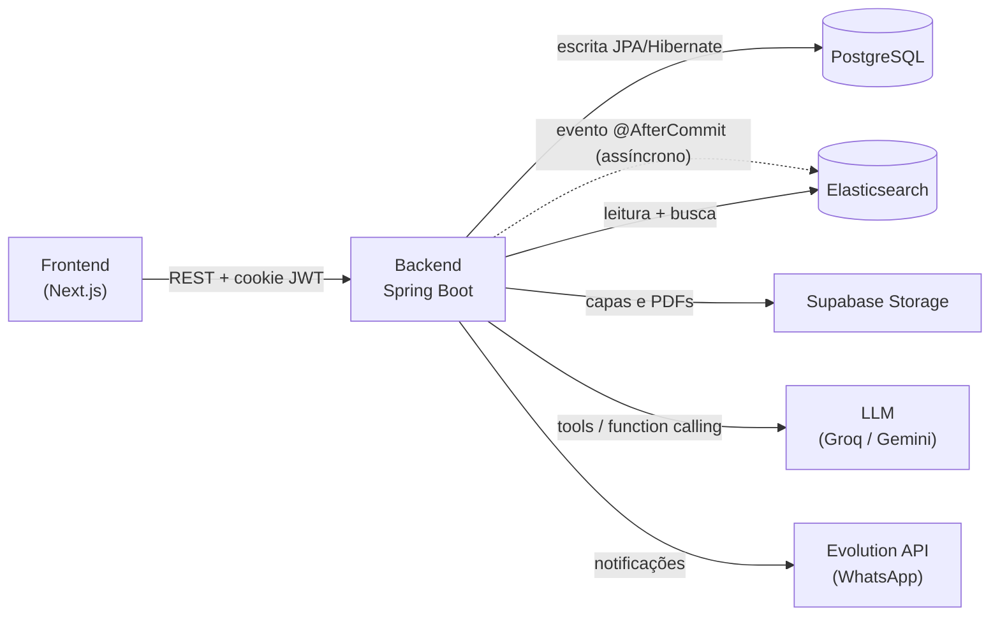

# SmartTeca — Backend

Sistema de gestão de biblioteca acadêmica com **assistente de IA**, desenvolvido como Trabalho de Conclusão de Curso para a Biblioteca Monsenhor Luiz Gualberto de Andrade (Faculdade Católica da Paraíba).

API REST em **Spring Boot 3.5 / Java 21** que combina **PostgreSQL** (fonte da verdade) com **Elasticsearch** (leitura e busca), integra um **chatbot com function calling**, armazenamento de arquivos no **Supabase** e notificações via **WhatsApp**.

---

## Destaques técnicos

- **Persistência dupla (CQRS-like):** escrita transacional no PostgreSQL e, após o commit, indexação **assíncrona** no Elasticsearch via eventos de domínio — leitura rápida e busca tolerante a erros desacopladas da escrita.
- **Segurança robusta:** autenticação **JWT em cookies HttpOnly** (access + refresh), senhas com BCrypt, **hierarquia de papéis**, autorização por método (`@PreAuthorize`), **rate limiting** (Bucket4j) e cabeçalhos de segurança (CSP, HSTS, X-Frame-Options).
- **Assistente de IA (SmartTeca):** integração com **Spring AI** + LLM (compatível com OpenAI — Groq/Gemini), usando **tools/function calling** para buscar no acervo, com memória de conversa.
- **Tratamento de erros centralizado:** `@RestControllerAdvice` mapeando exceções de domínio e do framework para respostas HTTP consistentes.
- **Integrações externas:** Supabase Storage (capas e PDFs), Evolution API (WhatsApp) e tarefas agendadas (cobrança de atraso).

---

## Arquitetura



**Fluxo de dados:** toda escrita vai para o PostgreSQL; após o commit, um evento assíncrono indexa o mesmo dado no Elasticsearch. As telas e o chatbot **leem do Elasticsearch**. Por isso a consistência é **eventual** — algo recém-cadastrado aparece assim que o evento de indexação processa.

---

## Tecnologias

| Camada | Stack |
|---|---|
| Linguagem / Framework | Java 21, Spring Boot 3.5 |
| Persistência | Spring Data JPA + PostgreSQL · Spring Data Elasticsearch |
| Segurança | Spring Security, JWT (java-jwt), Bucket4j |
| IA | Spring AI (modelo compatível com OpenAI) |
| Mapeamento / boilerplate | MapStruct, Lombok |
| Build | Gradle |
| Infra (dev) | Docker Compose (Elasticsearch, Redis, Evolution API) |

---

## Como rodar

### Pré-requisitos
- **JDK 21**
- **Docker** (para a infraestrutura local)
- Uma instância de **PostgreSQL** (ex.: [Neon](https://neon.tech), gratuito) e um projeto no **Supabase** (Storage)
- Uma chave de **LLM** (ex.: [Groq](https://console.groq.com) ou [Google AI Studio](https://aistudio.google.com/apikey))

### 1. Subir a infraestrutura
```bash
docker compose up -d
```
Sobe Elasticsearch (`:9200`), Redis e a Evolution API (`:8081`).

### 2. Configurar as variáveis de ambiente
Os segredos **não ficam no repositório** — são lidos via variáveis de ambiente. Copie o template e preencha:
```bash
cp tcc/.env.example .env   # depois preencha com seus valores
```
Defina-as no seu ambiente (IDE/terminal). Veja a lista completa em [`tcc/.env.example`](tcc/.env.example).

| Variável | Descrição |
|---|---|
| `DB_URL`, `DB_USERNAME`, `DB_PASSWORD` | Conexão PostgreSQL |
| `AI_API_KEY` (`AI_BASE_URL`, `AI_MODEL`) | LLM do chatbot |
| `JWT_SECRET` | Chave de assinatura do JWT |
| `SUPABASE_URL`, `SUPABASE_KEY` | Storage de arquivos |
| `EVOLUTION_APIKEY` | API key da Evolution (WhatsApp) |

### 3. Rodar a aplicação
```bash
cd tcc
./gradlew bootRun
```
A API sobe em `http://localhost:8080`.

---

## Configurar a Evolution API (WhatsApp)

1. Acesse o painel em `http://localhost:8081`.
2. Crie uma instância com o nome **`Biblioteca`**.
3. Abra as configurações e **leia o QR Code** para conectar o WhatsApp.

> Números de telefone devem estar no formato internacional (ex.: `5583999999999`).

---

## Principais endpoints

Base: `/api/v1`

| Método | Rota | Acesso | Descrição |
|---|---|---|---|
| `POST` | `/auth/login` | público | Login (`matricula`, `senha`) → cookies JWT |
| `POST` | `/auth/refresh` | público | Renova o token |
| `GET` | `/usuario/me` | autenticado | Perfil do usuário logado |
| `POST` | `/usuario` | Bibliotecário | Cadastra usuário |
| `GET` | `/livro/listar` | Aluno+ | Lista o acervo de livros |
| `POST` | `/livro/cadastrar` | Bibliotecário | Cadastra livro (multipart + capa) |
| `POST` | `/reserva/reservar` | Bibliotecário | Cria uma reserva |
| `POST` | `/chatbot/mensagem` | Aluno+ | Conversa com a SmartTeca |

CRUDs análogos existem para `livro-publico`, `tcc`, `material-estudo`, `curso`, `tema` e `reserva`.

> **Documentação interativa (Swagger UI):** `http://localhost:8080/swagger-ui.html`

---

## Papéis e permissões

Hierarquia: **Bibliotecário ⊃ Professor ⊃ Aluno**.

- **Aluno:** consulta o acervo, baixa materiais, usa o chatbot e vê suas reservas.
- **Professor:** tudo do Aluno + cadastra **materiais de estudo**.
- **Bibliotecário:** gestão completa (livros, TCCs, livros públicos, cursos, temas, reservas e usuários).

---

## Estrutura

```
tcc/src/main/java/com/tecnico/projeto/tcc
├── controller      # endpoints REST
├── service         # regras de negócio (interface + implement)
├── repository      # JPA + Elasticsearch (+ buscas customizadas)
├── model           # entidades JPA
├── document        # índices Elasticsearch
├── mapper          # MapStruct
├── request/response# DTOs
├── eventlistener   # sincronização Postgres → Elasticsearch
├── config          # security, ai, supabase, evolution
├── component       # tools de IA e envio de WhatsApp
├── scheduled       # tarefas agendadas
├── treatment       # exceções + handler global
└── validation      # validações customizadas (@Pdf, @Imagem)
```

---

## Melhorias futuras
- Cobertura de testes (unitários dos serviços + integração com Testcontainers).
- Busca **vetorial** (embeddings) no lugar da busca textual aproximada atual.
- Dockerfile do backend para deploy conteinerizado.
