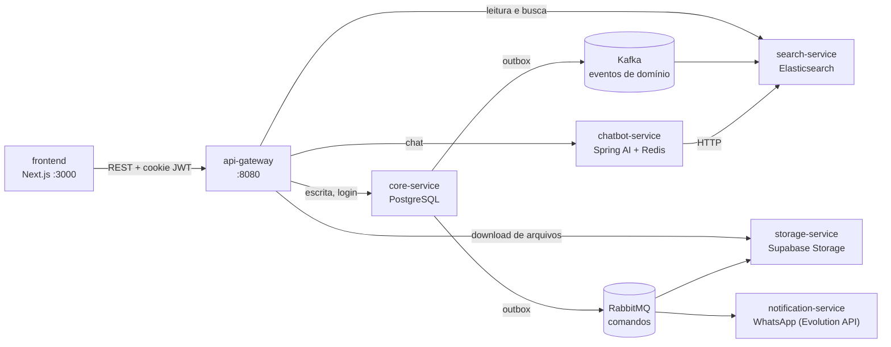

# SmartTeca

Sistema de gestão de biblioteca acadêmica com **assistente de IA**, nascido como Trabalho de Conclusão de Curso para a Biblioteca Monsenhor Luiz Gualberto de Andrade (Faculdade Católica da Paraíba) e reestruturado aqui como uma **arquitetura de microsserviços orientada a eventos**.

O repositório reúne o front-end (Next.js) e seis serviços Spring Boot (Java 21) que se comunicam por **Kafka** (fatos de domínio) e **RabbitMQ** (comandos com retentativa e fila morta), com o padrão **Transactional Outbox** garantindo que nenhum evento se perca entre o banco e o broker.

| | |
|---|---|
| **Back-end** | Java 21 · Spring Boot 4 · Spring Data JPA · Spring Security · Spring Cloud Gateway · Spring AI |
| **Dados** | PostgreSQL (escrita) · Elasticsearch (leitura e busca) · Redis (memória do chatbot) |
| **Mensageria** | Apache Kafka · RabbitMQ |
| **Front-end** | Next.js 16 · React 19 · TypeScript · Tailwind CSS 4 · TanStack Query |
| **Qualidade** | 629 testes Java (Testcontainers) + 75 testes de front (Jest) · CI no GitHub Actions |
| **Operação** | Docker Compose · manifests Kubernetes · Prometheus + Grafana |

---

## Arquitetura



| Serviço | Responsabilidade |
|---|---|
| `api-gateway` | Única porta de entrada. Valida o JWT (só tem a chave **pública**), aplica CORS e *rate limit*, e repassa a identidade aos serviços internos por cabeçalhos |
| `core-service` | Dono do PostgreSQL: autenticação, usuários, acervo, reservas, *outbox* e a rotina que detecta atrasos |
| `search-service` | Consome os eventos do Kafka, mantém os índices do Elasticsearch e serve listagens paginadas e busca textual |
| `storage-service` | Consome comandos de upload/exclusão (RabbitMQ) e serve downloads por *streaming* |
| `notification-service` | Envia mensagens de WhatsApp, uma por reserva atrasada |
| `chatbot-service` | Assistente com *tool calling* sobre o acervo; a memória da conversa vive no Redis |
| `common` | Só contratos compartilhados (envelope de evento, rotas públicas, *correlation id*) |

### Decisões de projeto

- **CQRS pragmático.** Toda escrita é transacional no PostgreSQL; a leitura vem do Elasticsearch, atualizado por eventos. A consistência é **eventual**: o front reconsulta com um pequeno atraso depois de cada escrita.
- **Transactional Outbox.** O serviço grava o evento na tabela `outbox_event` **na mesma transação** do dado. Um *relay* (`SELECT … FOR UPDATE SKIP LOCKED`) publica no Kafka/RabbitMQ e marca como enviado. Se o broker cair, nada se perde; se o relay rodar em duas réplicas, não há envio duplicado.
- **Kafka e RabbitMQ, cada um no seu papel.** Kafka carrega **fatos** (`livro-events`, `curso-events`, `reserva-events`…, 7 tópicos com 3 partições, chave = id do agregado, o que preserva a ordem por entidade). RabbitMQ carrega **comandos** (`storage.upload`, `storage.delete`, `notification.whatsapp.send`), cada um com *dead-letter queue* para inspeção quando o processamento falha.
- **Idempotência.** O `search-service` usa o id do agregado como id do documento: reprocessar um evento (entrega *at-least-once*) apenas regrava o mesmo documento.
- **Autenticação no gateway.** O JWT é RS256, assinado pelo `core-service` e validado **uma vez**, no gateway. Os serviços confiam nos cabeçalhos `X-User-*` (a rede interna do Docker impede chamadas diretas) e o gateway remove esses cabeçalhos se o cliente tentar enviá-los. Tokens ficam em cookies **HttpOnly**.
- **Estoque sem *overselling*.** O decremento de exemplares é um `UPDATE` atômico no banco, e o limite de 3 reservas por usuário é protegido por bloqueio de linha (`SELECT … FOR UPDATE`). Há testes de concorrência com PostgreSQL real.
- **Cadastro só pelo bibliotecário.** Não existe cadastro público; o primeiro bibliotecário nasce de variáveis de ambiente (`AdminSeeder`).

---

## Como rodar

### Pré-requisitos
- **Docker Desktop** (a stack inteira roda em containers)
- **Node 22+** (só para rodar o front fora do Docker ou os testes dele)
- **JDK 21** (só para rodar os testes Java ou compilar fora do Docker)
- Um projeto **Supabase** com 5 *buckets* de Storage (para capas e PDFs) e, para o chatbot, um LLM: [Ollama](https://ollama.com) local (padrão) ou qualquer API compatível com OpenAI

### 1. Configurar o ambiente
```bash
cp .env.example .env
```
Preencha o `.env` (ele está no `.gitignore`):

| Variável | Para quê |
|---|---|
| `JWT_PRIVATE_KEY` / `JWT_PUBLIC_KEY` | Par RSA (comandos `openssl` no próprio `.env.example`) |
| `ADMIN_MATRICULA` / `ADMIN_SENHA` | Primeiro bibliotecário (senha: 8+ caracteres, com maiúscula, minúscula e número) |
| `SUPABASE_URL` / `SUPABASE_KEY` | Storage. Buckets: `livro-capa`, `livro-publico-capa`, `livro-publico-conteudo`, `material-conteudo`, `tcc-conteudo` |
| `AI_*` | LLM do chatbot (o padrão é o Ollama no próprio computador, modelo `qwen3:8b`) |

### 2. Subir tudo
```bash
docker compose up -d --build
```

| Serviço | Endereço |
|---|---|
| Front-end | http://localhost:3000 |
| API (gateway) | http://localhost:8080 |
| RabbitMQ (painel) | http://localhost:15672 |
| Grafana / Prometheus | http://localhost:3001 / http://localhost:9090 |
| Evolution API (WhatsApp) | http://localhost:8081 |

### 3. Dados de demonstração
```bash
node scripts/seed-demo.mjs
```
Cria cursos, temas, 12 livros, 6 livros públicos, 6 TCCs, 6 materiais de estudo, usuários e algumas reservas, usando só a API do gateway. É idempotente. Se o Supabase foi configurado **depois** do seed, reenvie os arquivos com `node scripts/seed-demo.mjs --reenviar-arquivos`.

Contas criadas (senha `Demo12345`): `BIB00001` (bibliotecário), `PROF0001` (professor), `ALUNO0001` a `ALUNO0003` (alunos). **São contas de demonstração com senha pública: use só localmente.**

### Desenvolvimento do front-end
```bash
cd frontend
cp .env.example .env.local
npm ci
npm run dev        # http://localhost:3000 (pare o container `frontend` antes)
```

---

## Papéis

Hierarquia: **Bibliotecário ⊃ Professor ⊃ Aluno**.

- **Aluno:** consulta o acervo (livros, livros públicos, TCCs, materiais), baixa PDFs, vê suas reservas e usa o assistente.
- **Professor:** tudo do aluno, mais cadastrar e editar **materiais de estudo**.
- **Bibliotecário:** gestão completa — acervo, cursos, temas, **empréstimos e devoluções** (no balcão, informando a matrícula do aluno) e cadastro de usuários.

---

## Testes

```bash
./gradlew build            # 629 testes Java; exige o Docker ligado (Testcontainers)
cd frontend && npm test    # 75 testes de front (Jest + Testing Library)
```

Os testes de integração Java sobem **PostgreSQL, Kafka, RabbitMQ, Redis e Elasticsearch reais** com Testcontainers, em vez de simulá-los. Isso valeu a pena: foi assim que apareceram, por exemplo, um *overselling* de estoque (20 reservas simultâneas do último exemplar deixavam passar 10), erros 4xx virando 500, e um teto de 10 mil documentos na listagem.

O CI (`.github/workflows/ci.yml`) roda o build e os testes Java, o lint, os tipos, os testes e o build do front, e compila as imagens Docker de todos os serviços.

---

## Desempenho (medido)

Números medidos nesta própria stack, antes de qualquer mudança:

| Problema encontrado | Medição | Correção |
|---|---|---|
| Listagem trazia o índice inteiro | 3 mil livros: **1,7 MB** por chamada e **30 mil nós de DOM**; acima de **10 mil** documentos o Elasticsearch recusava a consulta | Paginação no servidor (`pagina`, `tamanho`, total no header `X-Total-Count`) + filtro de curso no servidor + `GET /{id}` para o detalhe. Com 11 mil livros: **12,9 KB, 31 ms, 325 nós de DOM** |
| Total de itens travado em 10.000 | Elasticsearch trunca o total sem `track_total_hits` | Consulta própria com total exato |
| Chatbot lento com modelo local | `qwen3:8b` gastava ~4× mais tokens "pensando": **58 s** por pergunta | `reasoning_effort=none`: **14 s** na mesma pergunta, com resposta idêntica (e 3,7 s contra 20,8 s numa pergunta simples) |

---

## Observabilidade e Kubernetes

- Todos os serviços expõem métricas em `/actuator/prometheus`; o Grafana já vem com painéis (latência, erros, filas do RabbitMQ, atraso de consumo do Kafka). Um `X-Correlation-Id` atravessa HTTP e mensagens e aparece em todos os logs.
- `k8s/` traduz a topologia do Compose em manifests (`kind` para testar localmente). Infra com réplica única, de propósito: é um portfólio, não um cluster de produção. **O front-end ainda não tem manifest.**

---

## Limitações conhecidas

Decisões conscientes e pontos que eu trataria antes de produção:

- **Materiais de estudo não têm dono:** qualquer professor edita ou exclui o material de outro.
- **Não há tela para desativar usuários nem para trocar senha.** O campo `ativo` já é respeitado (login, renovação e cada requisição), mas desativar hoje exige acesso ao banco.
- ***Rate limit* em memória**, por IP, válido para uma réplica do gateway. Atrás de um proxy confiável, defina `RATE_LIMIT_PROXIES_CONFIAVEIS`; com o padrão (0), o cabeçalho `X-Forwarded-For` do cliente é ignorado de propósito.
- **Identidade por cabeçalhos internos**, sem mTLS entre serviços: a proteção é o isolamento de rede.
- **Busca textual**, não vetorial, e limitada aos 20 resultados mais relevantes; a navegação paginada alcança no máximo as 10 mil primeiras posições.
- **Chatbot:** só consulta o acervo (não vê reservas) e a latência depende do modelo escolhido.
- **Sem tracing distribuído** (só *correlation id* + métricas) e sem CD: o CI só prova que as imagens constroem.

---

## Desenvolvimento assistido por IA

Este projeto foi construído com apoio de ferramentas de IA generativa (Claude Code) como par de programação, revisor e mentor de estudo. As decisões de arquitetura estão justificadas neste documento, e os testes (inclusive os de concorrência e de integração com infraestrutura real) existem justamente para não depender de confiança no código gerado.

---

## Estrutura

```
├── api-gateway/  core-service/  search-service/  storage-service/
├── notification-service/  chatbot-service/  common/
├── frontend/             # Next.js (src/app, components, hooks, services, lib)
├── scripts/seed-demo.mjs # dados de demonstração via API
├── docker-compose.yml  Dockerfile
├── k8s/  observability/  .github/workflows/
```
